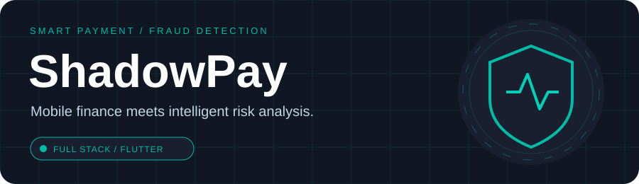
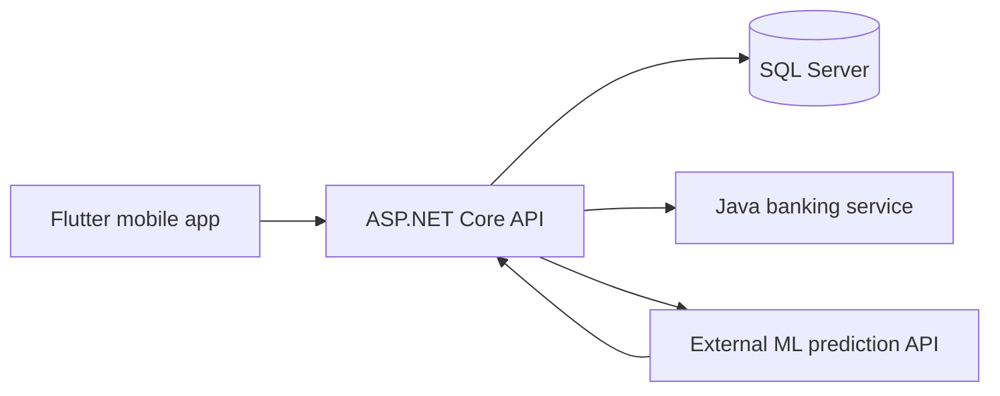

<div align="center">


# ShadowPay — Smart Payment & Fraud Detection

**A Flutter-based financial application connecting payment workflows with fraud-risk analysis.**


</div>

## Overview

ShadowPay is a collaborative university project that combines a cross-platform mobile interface, an ASP.NET Core API and integrations with banking and machine-learning services. Its goal is to bring transaction management and fraud-risk awareness into a single mobile experience.

## Mobile experience

| Module | Functionality represented in the app |
| --- | --- |
| Onboarding & authentication | Onboarding, registration, login, OTP and password recovery screens |
| Home | Dashboard, virtual card, quick actions and recent activity |
| Transactions | Add transactions and browse transaction history |
| Analytics | Analytics and risk-analysis screens |
| Account | Profile, card management, settings and reporting screens |
| Personalization | Arabic and English localization, light and dark themes |

## System architecture



The API contains account, profile, refresh-token and transaction controllers. Transaction handling includes a request to an external ML prediction endpoint and stores a fraud indicator. The wider project uses Java banking services and a FastAPI ML integration, as described in the project team overview; their implementations are not included in this repository.

## Engineering stack

| Layer | Technologies |
| --- | --- |
| Mobile | Flutter, Dart, Material UI |
| State & networking | BLoC/Cubit, Provider, Dio, HTTP |
| Persistence & localization | Secure Storage, SharedPreferences, Flutter localization |
| Visualization | fl_chart |
| Backend | ASP.NET Core 8, EF Core, Identity, JWT, Swagger |
| Database | SQL Server |
| Integration | Java banking service, external fraud prediction API |

## Repository structure

```text
ShadowPay/
├── shadow_pay_app/
│   ├── lib/
│   │   ├── screens/
│   │   ├── logic/
│   │   ├── services/
│   │   ├── providers/
│   │   ├── theme/
│   │   └── l10n/
│   └── pubspec.yaml
├── shadowpay_api/
│   ├── Controllers/
│   ├── Services/
│   ├── Models/
│   ├── Data/
│   └── Migrations/
└── docs/
```

## Getting started

Clone the repository:

```bash
git clone https://github.com/RodainaMohamed9/ShadowPay.git
cd ShadowPay
```

Mobile setup (Flutter SDK compatible with Dart 3.5.4 or newer within the declared constraint):

```bash
cd shadow_pay_app
flutter pub get
flutter run
```

Backend setup (from repository root, .NET 8 SDK required):

```bash
cd shadowpay_api
dotnet restore
dotnet run
```

Configure the SQL Server connection, authentication and email settings, and reachable banking/ML service endpoints before attempting end-to-end flows. Use local secrets or environment configuration rather than committing credentials.

## My contribution

**Rodaina Mohamed — Flutter mobile development.** My focus in this collaborative project was the mobile interface and user experience, including onboarding, authentication-related screens and the home/reporting experience.

## Project status

Academic project. The repository documents the implemented code and intended integrations; production security, model accuracy and live service availability have not been independently validated.

---

<div align="center">

**Thoughtful mobile experiences for smarter financial decisions.**

[Developer profile](https://github.com/RodainaMohamed9)

</div>
